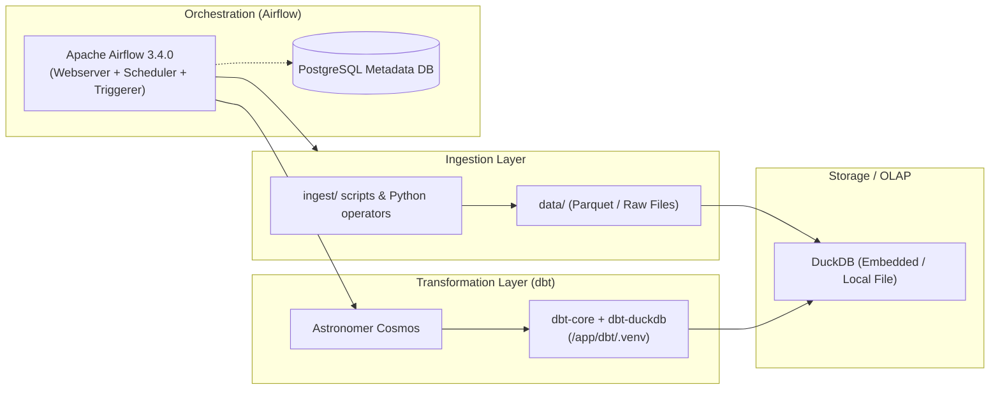

# DuckDB + dbt + Apache Airflow (ADT Stack)

A modern, lightweight analytical data stack combining **DuckDB**, **dbt**, and **Apache Airflow 3**, orchestrated with **Astronomer Cosmos** and managed using **uv** workspaces.

---

## Architecture Overview



### Key Highlights
- **In-Process Analytical Engine**: [DuckDB](https://duckdb.org/) delivers ultra-fast SQL queries directly on columnar files (Parquet/CSV) and local database files without external warehouse overhead.
- **Orchestration with Cosmos**: [Astronomer Cosmos](https://astronomer.github.io/astronomer-cosmos/) translates dbt projects into native Airflow DAGs and task groups with full lineage, logging, and test execution.
- **Isolated Virtual Environments**: dbt runs in an isolated Python environment (`/app/dbt/.venv`) to completely prevent dependency clashes between `dbt-core` and Airflow dependencies.
- **Blazing Fast Package Management**: Managed via Astral [uv](https://docs.astral.sh/uv/) using workspace configurations (`uv.lock`) for reproducible and near-instant builds.

---

## Project Structure

```text
.
├── airflow/               # Airflow DAGs, plugins, and custom tasks (mounted to /opt/airflow/dags)
├── config/                # Airflow configurations (airflow.cfg)
├── data/                  # DuckDB databases and raw data files (mounted to /app/data)
├── dbt/                   # dbt project directory
│   ├── pyproject.toml     # dbt dependencies (dbt-core, dbt-duckdb, sqlfluff)
│   ├── models/            # dbt transformation models
│   ├── dbt_project.yml    # dbt project definition
│   └── profiles.yml       # DuckDB dbt connection profiles
├── ingest/                # Custom ingestion scripts, connectors, and helper modules
├── .env                   # Environment variables (Airflow credentials, UID, versions)
├── .dockerignore           # Docker build context exclusions
├── Dockerfile             # Multi-stage image build with uv and isolated dbt venv
├── docker-compose.yaml    # Airflow services, PostgreSQL backend, and volume bindings
├── pyproject.toml         # Root project dependencies & uv workspace definition
└── uv.lock                # Deterministic lockfile across root and dbt projects
```

---

## Getting Started

### Prerequisites
- [Docker](https://docs.docker.com/get-docker/) & [Docker Compose v2](https://docs.docker.com/compose/)
- [uv](https://docs.astral.sh/uv/getting-started/installation/) *(optional, for local development outside Docker)*

### 1. Environment Setup
Review or customize the [.env](file:///.env) file:

```bash
# Python & Airflow versions
PYTHON_VERSION=3.12
AIRFLOW_VERSION=3.4.0
AIRFLOW_UID=50000

# Airflow UI default admin credentials
_AIRFLOW_WWW_USER_USERNAME=airflow
_AIRFLOW_WWW_USER_PASSWORD=airflow
```

Ensure local file permissions match your user ID:
```bash
echo "AIRFLOW_UID=$(id -u)" >> .env
```

### 2. Start the Stack
Build and launch all services with Docker Compose:

```bash
docker compose up --build -d
```

The stack initializes the PostgreSQL metadata database, applies migrations, creates the default admin user, and starts:
- **`airflow-webserver`**: Web UI accessible at [http://localhost:8080](http://localhost:8080)
- **`airflow-scheduler`**: DAG scheduler and executor
- **`airflow-triggerer`**: Async trigger runner for deferrable operators
- **`postgres`**: Metadata store on port 5432

Login with credentials:
- **Username**: `airflow`
- **Password**: `airflow`

### 3. Stopping the Stack
```bash
docker compose down
```
To remove persistent database volumes as well:
```bash
docker compose down -v
```

---

## Orchestrating dbt with Astronomer Cosmos

Because dbt is installed in an isolated environment (`/app/dbt/.venv`), configure your Cosmos `ExecutionConfig` in your Airflow DAGs to use that environment:

```python
from pathlib import Path
from airflow.decorators import dag
from pendulum import datetime
from cosmos import DbtDag, ProjectConfig, ProfileConfig, ExecutionConfig
from cosmos.profiles import DuckDBUserPasswordProfileMapping

DBT_PROJECT_PATH = Path("/app/dbt")
DBT_EXECUTABLE_PATH = Path("/app/dbt/.venv/bin/dbt")

profile_config = ProfileConfig(
    profile_name="duckdb_project",
    target_name="dev",
    profile_mapping=DuckDBUserPasswordProfileMapping(
        conn_id="duckdb_default",
        profile_args={"path": "/app/data/main.duckdb"},
    ),
)

execution_config = ExecutionConfig(
    dbt_executable_path=DBT_EXECUTABLE_PATH,
)

@dag(schedule_interval="@daily", start_date=datetime(2026, 1, 1), catchup=False)
def dbt_pipeline():
    DbtDag(
        project_config=ProjectConfig(DBT_PROJECT_PATH),
        profile_config=profile_config,
        execution_config=execution_config,
    )

dbt_pipeline()
```

---

## Local Development (Outside Docker)

If you develop locally using `uv`:

1. **Install root dependencies (Airflow, Ingest, Providers)**:
   ```bash
   uv sync
   ```

2. **Install dbt dependencies into the dbt subproject**:
   ```bash
   UV_PROJECT_ENVIRONMENT=dbt/.venv uv sync --project dbt
   ```

3. **Code Quality and Linting**:
   ```bash
   # Python linting and formatting
   uv run ruff check .
   uv run ruff format .

   # SQL linting (inside dbt project)
   uv run --project dbt sqlfluff lint dbt/models/

   # Run tests
   uv run pytest
   ```

---

## Volume Persistence Notes

- **DuckDB Data**: Stored in `./data` on the host, mapped to `/app/data` inside containers.
- **dbt Virtual Environment**: Mounted with an anonymous volume `/app/dbt/.venv` in `docker-compose.yaml` to ensure local `./dbt` host edits do not mask the container's built virtual environment.
- **Logs**: Preserved in the `logs` Docker volume and accessible through the Airflow UI.
